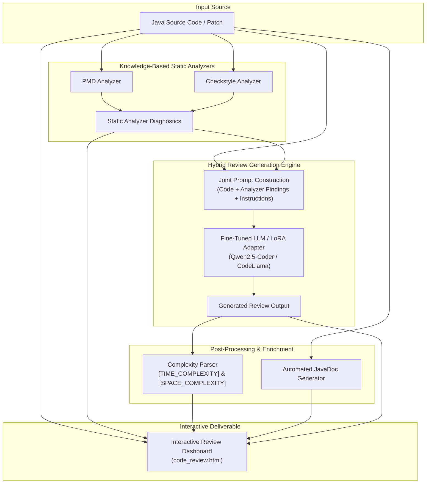

# CodeGuardian: Combining Large Language Models with Static Analyzers for Code Review Generation

[](https://conf.researchr.org/home/msr-2025)
[](https://www.python.org/)
[](https://pytorch.org/)
[](https://huggingface.svg)
[](#citation)

**CodeGuardian** is a hybrid automated code review framework that bridges the gap between **Knowledge-Based Systems (KBS)** (rule-based static analyzers like PMD and Checkstyle) and **Learning-Based Systems (LBS)** (Large Language Models like CodeLlama and Qwen2.5-Coder).

By integrating deterministic static analysis violations with the contextual comprehension and natural language capabilities of LLMs, CodeGuardian produces code review comments that are accurate, comprehensive, actionable, and grounded in both syntax standards and semantic intent.

---

## Table of Contents

- [Motivation & Core Concept](#motivation--core-concept)
- [Hybrid Integration Strategies](#hybrid-integration-strategies)
- [Key Features](#key-features)
- [System Architecture](#system-architecture)
- [Repository Structure](#repository-structure)
- [Prerequisites & Installation](#prerequisites--installation)
- [Step-by-Step Workflow](#step-by-step-workflow)
  - [1. Data Preparation & Preprocessing](#1-data-preparation--preprocessing)
  - [2. Model Training with LoRA](#2-model-training-with-lora)
  - [3. Inference & Review Generation](#3-inference--review-generation)
  - [4. Interactive HTML Dashboard](#4-interactive-html-dashboard)
  - [5. LLM-as-a-Judge Evaluation](#5-llm-as-a-judge-evaluation)
- [Experimental Results](#experimental-results)
- [Citation](#citation)
- [Acknowledgments](#acknowledgments)

---

## Motivation & Core Concept

Automated code review systems conventionally fall into two complementary paradigms:

| Paradigm | Strengths | Limitations |
| :--- | :--- | :--- |
| **Static Analyzers (KBS)**<br>*(e.g., Checkstyle, PMD)* | Strict adherence to rules, deterministic precision, zero hallucination on predefined violation patterns. | Rigid rulesets, inability to reason about higher-level semantic intent, high false-alarm noise, lacks conversational guidance. |
| **Large Language Models (LBS)**<br>*(e.g., CodeLlama, Qwen2.5-Coder)* | Deep contextual understanding, intent inference, natural language suggestions, synthesis across files. | Susceptible to hallucinations, inconsistent precision on edge-case syntax/style rules, unbounded outputs. |

**CodeGuardian** synthesizes these complementary approaches into an end-to-end review engine that eliminates hallucinations while maintaining rich contextual explanations, asymptotic complexity evaluations, and automatic documentation generation.

---

## Hybrid Integration Strategies

As detailed in the MSR 2025 research paper, CodeGuardian studies static analyzer integration across three distinct stages:

```
  +--------------------------------------------------------------------------+
  |                        Integration Strategies                            |
  +--------------------------------------------------------------------------+
                                       |
       +-------------------------------+-------------------------------+
       |                               |                               |
       v                               v                               v
[ Strategy 1: DAT ]             [ Strategy 2: RAG ]             [ Strategy 3: NCO ]
Data-Augmented Training         Retrieval-Augmented Gen.        Naive Concatenation
Static outputs injected into    Static reports dynamically      Post-inference merge of
fine-tuning prompts (LoRA/SFT)  retrieved at inference time     raw static tool reports &
to learn joint representations. into LLM context window.        generative LLM reviews.
```

1. **Data-Augmented Training (DAT / FTr)**: The model is fine-tuned on paired prompts containing code diffs and static analyzer diagnostic reports, training the LLM to learn joint representations and prioritize verified issues.
2. **Retrieval-Augmented Generation (RAG)**: The base LLM dynamically retrieves static analysis violation outputs at inference time and conditions review generation upon those retrieved findings.
3. **Naive Concatenation of Outputs (NCO / concat)**: Post-inference merging of raw static analyzer violations and LLM-generated review comments.

These strategies are empirically compared against baseline **Standalone Static Analysis (SA)** and **Standalone LLM Review (MLr)**.

---

## Key Features

- **Multi-Tool Static Analysis**: Built-in support for **PMD** (code flaws, design smells, dead code) and **Checkstyle** (coding standards, formatting, JavaDoc rules).
- **LoRA Parameter-Efficient Fine-Tuning (PEFT)**:
  - Lightweight training pipeline for `Qwen/Qwen2.5-Coder-0.5B-Instruct` (CPU/GPU-friendly).
  - Scalable SFT fine-tuning pipeline for `codellama/CodeLlama-7b-Instruct-hf` with Flash Attention and gradient accumulation.
- **Leakage-Free Dataset Splitting**: Group-aware dataset partitioning (`code + patch` key) preventing data contamination between train, validation, and test splits.
- **Asymptotic Complexity Extraction**: Automatically extracts and bounds both **Time Complexity** ($O(\dots)$) and **Space Complexity** ($O(\dots)$) from generated reviews.
- **Automatic JavaDoc Enrichment**: Regex and signature-aware parsing engine that detects undocumented classes and methods and drafts standard JavaDocs.
- **Interactive Web Dashboard (`code_review.html`)**: Beautiful, responsive HTML report showcasing side-by-side source code, static analyzer findings, generated JavaDocs, complexity metrics, and formatted AI review comments.
- **LLM-as-a-Judge Evaluation Pipeline**:
  - **Accuracy Judge**: Evaluates review accuracy (`Accurate`, `Partially Accurate`, `Not Accurate`) across all 5 strategies.
  - **Coverage / Completeness Judge**: Ranks reviews from 1 (most complete) to 5 (least complete).

---

## System Architecture



---

## Repository Structure

```plaintext
CodeGuardian/
├── README.md                              # Project documentation and guide
├── code_review.html                       # Generated interactive code review report
├── inference.py                           # End-to-end hybrid inference pipeline & HTML generator
├── inference_backup.py                    # Minimal CLI inference script
├── train_lora.py                          # Lightweight LoRA fine-tuning script (Qwen2.5-Coder)
├── transform_dataset_local.py             # Group-based dataset splitter and prompt formatter
├── convert_dataset.py                     # Pickle (.pkl) to CSV conversion utility
├── inspect_dataset.py                     # Dataset inspection and summary metrics
├── inspect_relationships.py               # Tool overlap and review distribution inspector
├── inspect_tools.py                       # Distribution and statistics across static tools
│
├── tools/                                 # Static analyzer binaries and configurations
│   ├── checkstyle/
│   │   └── checkstyle.jar                 # Checkstyle executable JAR
│   └── pmd/
│       ├── bin/                           # PMD launcher binaries (pmd, pmd.bat)
│       └── lib/                           # PMD dependencies and rule libraries
│
├── preparing_dataset_before_filtering/    # Raw dataset extraction and analysis scripts
│   ├── command_checkstyle.py              # Script executing Checkstyle across Java files
│   ├── command_pmd.py                     # Script executing PMD across Java files
│   ├── extract_reviews.py                 # XML/Text parser mapping tool logs to reviews
│   ├── formatting_java_file.py            # Code formatting via Google Java Format
│   └── google-java-format.jar             # Google Java Format executable
│
├── patches_extraction/                    # Patch and prompt processing utilities
│   ├── extract_patches.py                 # Methods and patch extraction around violation lines
│   └── filtering_long_prompts.py          # Tokenizer length filtering (< 2048 tokens)
│
├── training/                              # Deep learning training pipeline (CodeLlama-7B)
│   ├── balance.ipynb                      # Class/tool balancing analysis notebook
│   ├── config.py                          # Hyperparameter configuration and CLI parser
│   ├── training.py                        # SFTTrainer fine-tuning script with PEFT/LoRA
│   └── transform_dataset.py               # Prompt formatting and Hugging Face dataset export
│
├── RAG/                                   # Retrieval-Augmented Generation pipeline
│   ├── dataset_utils.py                   # RAG dataset loading and prompt formatting
│   └── run_inference.py                   # RAG batch inference execution
│
├── LLM_Judgment_acuracy/                  # LLM-as-a-judge: Accuracy benchmark
│   ├── config.py                          # Judge configuration
│   ├── inference.py                       # Evaluation runner (Llama-3 judge)
│   ├── prompt_templates.py                # 3-tier accuracy classification prompts
│   └── results21.jsonl                    # Benchmark accuracy evaluation logs
│
├── LLM_Judgment_coverage/                 # LLM-as-a-judge: Coverage / Completeness benchmark
│   ├── config.py                          # Judge configuration
│   ├── inference.py                       # Ranking runner (Llama-3 judge)
│   ├── prompt_templates.py                # 5-way comparative ranking prompt templates
│   └── results.jsonl                      # Benchmark coverage ranking logs
│
└── test_java/                             # Sample Java source files for demonstration
    └── TestExample.java                   # Sample Java class used in inference testing
```

---

## Prerequisites & Installation

### 1. System Requirements
- **Operating System**: Linux, macOS, or Windows
- **Python**: Version 3.9, 3.10, or 3.11
- **Java Runtime Environment**: Java 11 or higher (required by PMD and Checkstyle)
- **CUDA** (optional): Recommended for GPU acceleration (NVIDIA GPU with CUDA 11.8+ or 12.x)

### 2. Python Environment Setup

Clone the repository and set up a virtual environment:

```bash
git clone https://github.com/deepika-91/CodeGuardian.git
cd CodeGuardian

# Create and activate virtual environment
python3 -m venv venv
source venv/bin/activate       # On Windows: venv\Scripts\activate
```

Install core dependencies:

```bash
pip install --upgrade pip
pip install torch torchvision torchaudio --index-url https://download.pytorch.org/whl/cu121  # or standard wheels for CPU/Mac
pip install transformers peft datasets trl accelerate scikit-learn pandas numpy tqdm
```

### 3. Verify Java & Tool Paths

Verify that Java is available on your system path:

```bash
java -version
```

The static analyzer tools are located in `tools/`:
- **Checkstyle**: `tools/checkstyle/checkstyle.jar`
- **PMD**: `tools/pmd/bin/pmd` (Linux/macOS) or `tools/pmd/bin/pmd.bat` (Windows)

---

## Step-by-Step Workflow

### 1. Data Preparation & Preprocessing

The dataset preparation pipeline formats raw Java code, executes static analyzers, extracts patches around flagged issues, and partitions data safely:

```bash
# 1. Format raw Java files using Google Java Format
python preparing_dataset_before_filtering/formatting_java_file.py

# 2. Run static analysis across target codebases
python preparing_dataset_before_filtering/command_checkstyle.py
python preparing_dataset_before_filtering/command_pmd.py

# 3. Parse and extract violation comments into structured tabular format
python preparing_dataset_before_filtering/extract_reviews.py

# 4. Extract method patches and filter prompt token lengths
python patches_extraction/extract_patches.py
python patches_extraction/filtering_long_prompts.py

# 5. Partition dataset by code+patch groups to prevent split leakage
python transform_dataset_local.py
```

`transform_dataset_local.py` splits data into 80% train, 10% validation, and 10% test, saving the final `DatasetDict` to `processed_dataset_new_prompt/`.

### 2. Model Training with LoRA

#### Option A: Lightweight Training on Qwen2.5-Coder (CPU/GPU)

For quick demonstration or local experimentation:

```bash
python train_lora.py
```
This trains a Low-Rank Adapter (LoRA) on `Qwen/Qwen2.5-Coder-0.5B-Instruct` and saves the weights to `qwen_code_review_lora/`.

#### Option B: Full SFT Training on CodeLlama-7B (Multi-GPU)

For full research experiments using `CodeLlama-7b-Instruct-hf`:

```bash
python -m training.training \
    --model_name "codellama/CodeLlama-7b-Instruct-hf" \
    --num_epochs 5 \
    --batch_size 1 \
    --gradient_accumulation_steps 4 \
    --learning_rate 3e-4 \
    --max_sequence_length 1500 \
    --output_dir "output/codellama_lora"
```

### 3. Inference & Review Generation

To generate an end-to-end review for a target Java code snippet:

```bash
python inference.py
```

`inference.py` performs the following automated steps:
1. Loads the base model (`Qwen/Qwen2.5-Coder-0.5B-Instruct`) and attaches the trained LoRA adapter (`qwen_code_review_lora`).
2. Synthesizes static analyzer outputs (Checkstyle & PMD) with the source code into an instruction-tuned prompt.
3. Performs autoregressive generation with sampling parameters (`temperature=0.2`, `top_p=0.9`, `repetition_penalty=1.05`).
4. Extracts asymptotic complexity metrics (`[TIME_COMPLEXITY]` and `[SPACE_COMPLEXITY]`).
5. Generates missing JavaDoc comments for classes and methods.
6. Renders and outputs `code_review.html`.

### 4. Interactive HTML Dashboard

The generated `code_review.html` dashboard provides a clean visual interface for reviewing code:

- **Source Code Card**: Displays the target Java code snippet with syntax highlighting.
- **Static Analyzer Results**: Outlines exact violations flagged by Checkstyle and PMD.
- **Automatic JavaDoc Generation**: Displays automatically synthesized JavaDocs ready for insertion.
- **Complexity Analysis**: Visual metric boxes for estimated Time and Space complexity.
- **AI-Generated Review**: Structured feedback covering issues found, explanations, and suggested improvements.

Simply open `code_review.html` in any modern web browser:

```bash
# macOS
open code_review.html

# Linux
xdg-open code_review.html

# Windows
start code_review.html
```

### 5. LLM-as-a-Judge Evaluation

The framework provides an evaluation harness using high-capacity LLMs (such as Llama-3-70B/8B) to assess review quality:

#### Accuracy Classification

Evaluates whether reviews are `Accurate`, `Partially Accurate`, or `Not Accurate`:

```bash
python LLM_Judgment_acuracy/inference.py
```
Output results are recorded in `LLM_Judgment_acuracy/results21.jsonl`.

#### Coverage & Completeness Ranking

Compares and ranks the 5 approaches (`FTr`, `MLr`, `concat`, `RAG`, `SA`) from 1 (most complete) to 5 (least complete):

```bash
python LLM_Judgment_coverage/inference.py
```
Output results are recorded in `LLM_Judgment_coverage/results.jsonl`.

---

## Experimental Results

Key takeaways from the empirical evaluations in our MSR 2025 paper:

1. **Hybrid Superiority**: Hybrid strategies consistently outperform standalone LLM reviews (`MLr`) and standalone static analyzers (`SA`) in both correctness and actionable coverage.
2. **Hallucination Suppression**: Grounding LLMs with static analyzer findings (via DAT or RAG) drastically reduces hallucinated syntax, unused-variable claims, and style inaccuracies.
3. **Completeness & Depth**: While static analyzers only identify rule violations, hybrid models generate semantic explanations, refactored snippets, and complexity impact analyses that static analyzers cannot produce.

---

## Acknowledgments

This research was conducted at the **Department of Computer Science and Information Technolog, Koneru Lakshmaiah Education Foundation, Bowrampet, Hyderabad, India**. We are thank you to Associate Professor [Dr. Jagan Mohan Reddy](https://github.com/jmreddy2106) for his support and guidance throughout the research work. 

**CodeGuardian** is an open-source tool for automated software code review and quality assurance.
