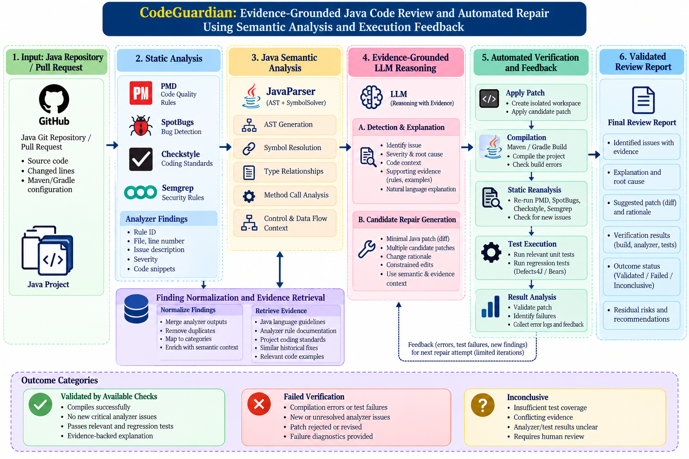

# CodeGuardian: Evidence-Grounded Java Code Review and Automated Repair Using Semantic Analysis and Execution Feedback

[](https://www.python.org/)
[](https://www.oracle.com/java/)
[](https://pytorch.org/)
[](https://huggingface.co/)
[](https://pmd.github.io/)
[](#acknowledgments)

**CodeGuardian** is an automated Java code review, explanation, and patch verification framework. It unifies **Knowledge-Based Systems (KBS)** (rule-based static analyzers including PMD, Checkstyle, and SpotBugs) and **Java Semantic Analysis** (AST and symbol resolution via JavaParser) with **Learning-Based Systems (LBS)** (Large Language Models like CodeLlama and Qwen2.5-Coder), governed by an **automated compilation and test-execution verification sandbox**.

Rather than treating static analysis, LLM explanation, and code repair as disconnected tasks, CodeGuardian makes **evidence consistency across detection, explanation, repair, and validation** its central technical principle.

---

## Table of Contents

- [The Research Problem & Gap](#the-research-problem--gap)
- [Core Contributions (C1–C3)](#core-contributions-c1c3)
- [Proposed End-to-End Architecture](#proposed-end-to-end-architecture)
- [System Architecture Diagram](#system-architecture-diagram)
- [Implementation Plan (4 Stages)](#implementation-plan-4-stages)
- [Datasets & Experimental Design](#datasets--experimental-design)
- [Evaluation Matrix & Metrics](#evaluation-matrix--metrics)
- [Research Questions (RQ1–RQ5)](#research-questions-rq1rq5)
- [Repository Structure](#repository-structure)
- [Environment Setup & Installation](#environment-setup--installation)
- [Workflow Execution](#workflow-execution)
- [Interactive HTML Review Dashboard](#interactive-html-review-dashboard)
- [Acknowledgments](#acknowledgments)

---

## System Architecture Diagram

[](CodeGuardian.png)


## The Research Problem & Gap

Recent 2026 research published in *IEEE Transactions on Software Engineering* (agentic program repair with test-execution feedback) and *IEEE Access* (dynamic context retrieval and static-analysis-driven repair) demonstrates that simply combining LLMs with static analyzers or naive test-execution feedback is no longer sufficiently distinctive on its own.

Existing approaches suffer from critical fragmentation:
1. **Shallow Static Context**: Traditional static analyzers flag terse violations (e.g., *"Potential null pointer dereference"*) without resolving surrounding type hierarchies, callers, or semantic intent.
2. **Ungrounded Explanations & Hallucinations**: Standalone LLMs generate plausible-sounding review commentary that frequently attributes errors to nonexistent lines or misinterprets Java language semantics.
3. **Unverified & Regressive Fixes**: Generative patch models produce candidate edits that may silence an analyzer warning by deleting functional code, introducing syntax breakages, or breaking downstream regression tests.
4. **Binary Over-Trust**: Assuming that any patch passing existing test suites is automatically correct overlooks test suite inadequacy and subtle regressions.

**CodeGuardian** addresses these limitations by enforcing **end-to-end evidence consistency**:
> When an issue (e.g., unsafe Java null dereference) is detected, its explanation must identify the concrete nullable value and execution path. Its candidate patch must address that specific path, and the verification stage must systematically validate that behavior through compiler checks, reanalysis, and focused test execution.

---

## Core Contributions (C1–C3)

| Contribution | Proposed Mechanism | What Makes It Testable |
| :--- | :--- | :--- |
| **C1. Java-Aware Issue Grounding** | Resolves types, methods, symbols, and surrounding dependencies using AST and symbol-solver passes (JavaParser + SymbolSolver) before prompting the review model. | Compare issue-level Precision, Recall, and $F_1$ with and without semantic context against ground-truth defect benchmarks. |
| **C2. Evidence-Linked Explanations & Fixes** | Links every generated explanation and candidate patch directly to concrete source findings, rule definitions, and retrieved coding standards. | Quantify human-judged explanation correctness and the *unsupported-claim rate* (frequency of model assertions unsupported by code or rule evidence). |
| **C3. Verification-Guided Repair Selection** | Rejects, filters, or iteratively refines patches using isolated compiler, analyzer re-execution, and regression test feedback, producing tri-state review verdicts. | Measure correct repair rate, regression rate, false verified-fix acceptance rate, and token/compute cost. |

---

## Proposed End-to-End Architecture

The CodeGuardian framework operates across seven coordinated components:

```
+---------------------------------------------------------------------------------------------------------+
|                                        CodeGuardian Pipeline                                            |
+---------------------------------------------------------------------------------------------------------+
  1. Java Git Repo / PR        --> Source code, changed hunks, Maven/Gradle build configurations
  2. Multi-Tool Static Analysis--> PMD, Checkstyle, SpotBugs, Semgrep
  3. Java Semantic Analysis    --> AST parsing, symbol resolution, method invocations, type hierarchies
  4. Finding Normalization &   --> Canonical finding records + guideline retrieval (RAG) + verified fixes
     Evidence Retrieval
  5. Evidence-Grounded LLM     --> Root-cause detection, severity, structured explanation, minimal patch
     Reasoning & Repair
  6. Automated Verification    --> Sandbox patch application -> compilation -> reanalysis -> regression
  7. Validated Review Report   --> Tri-state verdict: [Validated by checks | Failed verification | Inconclusive]
```

### 1. Java Git Repository & Pull Request Ingestion
- Extracts modified files, hunk boundaries, and lines from Git diffs.
- Ingests build definitions (`pom.xml`, `build.gradle`) to identify dependencies, source targets, and test suites.

### 2. Multi-Tool Static Analysis
- Executes industry-standard analyzers:
  - **PMD**: Uncovers code smells, questionable constructs, dead code, and concurrency defects.
  - **Checkstyle**: Audits adherence to formatting standards, JavaDoc completeness, and naming conventions.
  - **SpotBugs**: Detects bytecode-level defect patterns, null pointer dereferences, and security vulnerabilities.

### 3. Java Semantic Analysis (AST & Symbol Resolution)
- Employs **JavaParser with SymbolSolver** on compilable project snapshots.
- Resolves fully qualified types, variable declaration scopes, method override relationships, and control/data dependencies around changed regions.

### 4. Finding Normalization & Evidence Retrieval
- Transforms diverse tool outputs into canonical finding records:
  $$\text{Finding} = \langle \text{File}, \text{Line}, \text{RuleID}, \text{Severity}, \text{AST Context}, \text{Tool Output} \rangle$$
- Retrieves top-$k$ relevant coding standards, rule documentation, and verified historical patches from an embedded vector corpus.

### 5. Evidence-Grounded LLM Reasoning & Candidate Repair
- Generates structured review explanations detailing the underlying issue, severity, execution path, and root cause.
- Synthesizes minimal candidate Java patches (unified diff format) constrained strictly to relevant files without unrequested modifications to build or test configurations.

### 6. Automated Multi-Stage Verification
Executes in an isolated sandbox environment:
1. **Patch Application**: Applies candidate diffs cleanly against target files.
2. **Compilation Verification**: Validates compilation via Maven (`mvn compile`).
3. **Static Reanalysis**: Re-runs PMD, SpotBugs, and Checkstyle to ensure target violations are resolved without introducing new warnings.
4. **Focused & Regression Testing**: Executes unit and integration test suites (`mvn test`).
5. **Iterative Diagnostics Feedback**: Returns compiler errors and failing test traces back to the model for a bounded number of refinement attempts.

### 7. Validated Review Report
Categorizes outcomes into three unambiguous states:
- **`Validated by Available Checks`**: Patch cleanly applies, compiles, eliminates target issues, introduces no new static violations, and passes all test suites.
- **`Failed Verification`**: Candidate patch fails compilation, reintroduces violations, or causes regression test failures after maximum retry attempts.
- **`Inconclusive`**: Issue and explanation are verified, but no conclusive patch or test suite coverage is available to prove correctness mechanically. Residual risks are explicitly documented.

---

## Implementation Plan (4 Stages)

CodeGuardian is built in four independent, testable stages:

```
Stage 1: Issue Detection & Java Context  ---> Deliverable: Normalized findings with symbol provenance
Stage 2: Explanation & Rule Retrieval    ---> Deliverable: Auditable, evidence-backed review report
Stage 3: Candidate Patch Generation      ---> Deliverable: Minimal, reproducible candidate diffs
Stage 4: Verification & Feedback Loop    ---> Deliverable: Verified patch execution & tri-state report
```

### Stage 1 — Issue Detection & Java Context
- Integrate PMD, Checkstyle, and SpotBugs.
- Embed **JavaParser with SymbolSolver** to resolve variable declarations, method invocations, and enclosing class hierarchies around each finding.
- **Deliverable**: Normalized finding objects containing file, line, rule, surrounding AST context, and symbol provenance.

### Stage 2 — Explanation & Retrieval
- Build a versioned retrieval corpus comprising Java language specifications, analyzer rule catalogs, organization guidelines, and verified historical fixes.
- Query the corpus using structured finding metadata to supply grounding context to the LLM.
- **Deliverable**: An auditable, structured review report (root cause, severity, evidence) rather than an ungrounded natural-language paragraph.

### Stage 3 — Candidate Patch Generation
- Prompt the model for minimal, syntactically valid unified diffs targeted strictly to the issue region.
- Prevent unrequested modifications to tests, dependencies, or unrelated methods.
- Employ AST-aware rule transformations for deterministic style and hygiene remediation where appropriate.
- **Deliverable**: Reproducible Java patch proposals paired with reasoning logs.

### Stage 4 — Verification & Feedback Loop
- Apply candidate patches inside isolated workspaces.
- Compile via `mvn compile`, rerun static analyzers, and execute regression test suites (`mvn test`).
- Return compiler diagnostics and test failure traces back to the generator for up to $N$ iterations.
- **Deliverable**: Fully verified review verdicts, failure logs, and patch attempt histories.

---

## Datasets & Experimental Design

Evaluating both code-quality issue detection and functional defect repair requires two complementary, high-integrity benchmarks:

| Benchmark | Primary Purpose | Scope & Description |
| :--- | :--- | :--- |
| **Defects4J** | Functional Bug Repair & Test Verification | Widely accepted benchmark of real Java bugs with reproducible failing test suites and verified human patches. [Defects4J Repository](https://github.com/rjust/defects4j) |
| **Bears** | Build Reproducibility & Bug Diversity | Java defect benchmark with reproducible branch histories across diverse build systems. [Bears Benchmark](https://github.com/bears-bugs/bears-benchmark) |
| **Curated Java Analyzer Findings** | Rule Detection, Explanation & Static Remediation | Large corpus of real-world open-source Java pull requests evaluated across PMD, Checkstyle, and SpotBugs. Stratified, double-labeled human validation to avoid treating static warnings as ground truth. |

### Leakage Controls & Splitting Strategy
- **Repository-Level & Temporal Partitioning**: Training, validation, and testing sets are partitioned strictly by repository and commit timestamp to ensure zero test contamination.
- **Compilable Project Reconstructions**: Analyzers and AST solvers run on fully resolved, compilable project snapshots rather than isolated diff hunks.

---

## Evaluation Matrix & Metrics

| Dimension | Metric | Definition & Evaluation Target |
| :--- | :--- | :--- |
| **Detection Quality** | Precision, Recall, $F_1$ | Accuracy of identified issues against annotated ground-truth defects and confirmed violations. |
| **Explanation Faithfulness** | Explanation Correctness | Human-evaluated accuracy of the root-cause diagnosis and reasoning. |
| | Unsupported-Claim Rate | Percentage of generated review comments making assertions not grounded in code or rule evidence. |
| **Fix Generation** | Patch Application Rate | Percentage of candidate patches that apply cleanly via `git apply`. |
| | Compilation Success Rate | Fraction of generated patches that compile successfully without syntax or type errors. |
| **Repair Correctness** | Correct Repair Rate | Percentage of patches that completely resolve the defect without regression. |
| **Verification Reliability** | **False Verified-Fix Acceptance** | Frequency at which the verification pipeline marks a patch as *validated* when it is actually incorrect or overfits. |
| | Regression Rate | Percentage of patches that break previously passing tests or introduce new static warnings. |
| **Operational Efficiency** | Runtime & Token Overhead | Wall-clock latency per pull request, model invocation count, GPU/CPU utilization, and token expenditure. |

### Controlled Ablation Study Plan
1. **w/o Semantic Context**: Disables JavaParser symbol resolution (evaluates contribution C1).
2. **w/o Retrieved Guidelines**: Disables RAG corpus grounding (evaluates contribution C2).
3. **w/o Evidence Constraints**: Unrestricts LLM prompts from finding provenance (evaluates hallucination reduction).
4. **w/o Verification Feedback**: Disables compiler/test feedback loops (evaluates contribution C3).

---

## Research Questions (RQ1–RQ5)

The experimental investigation addresses five core research questions:

- **RQ1 (Semantic Grounding)**: *To what extent does Java-specific semantic analysis (AST and symbol resolution) improve the detection and precision of actionable code review issues?*
- **RQ2 (Explanation Faithfulness)**: *Does evidence-grounded retrieval significantly reduce unsupported claims and improve the correctness and developer usefulness of generated review comments?*
- **RQ3 (Dual-Domain Repair)**: *Can the proposed framework synthesize syntactically and semantically correct patches for both static-analysis violations and functional Java defects?*
- **RQ4 (Verification Reliability)**: *How effectively does execution-based multi-stage verification detect incorrect, regressive, or overfitting candidate patches compared to unverified LLM generation?*
- **RQ5 (Computational Efficiency)**: *What computational and token overhead does the end-to-end framework introduce compared to static-only, LLM-only, and conventional RAG pipelines?*

---

## Repository Structure

```plaintext
CodeGuardian/
├── README.md                              # Core project documentation and research specifications
├── CodeGuardian.tex                       # IEEE conference manuscript source file
├── code_review.html                       # Interactive HTML code review dashboard output
├── inference.py                           # Hybrid inference engine, complexity analyzer & HTML generator
├── inference_backup.py                    # Minimal CLI inference script
├── train_lora.py                          # Lightweight LoRA fine-tuning script (Qwen2.5-Coder)
├── transform_dataset_local.py             # Group-based dataset splitter and prompt formatter
├── convert_dataset.py                     # Pickle (.pkl) to CSV conversion utility
├── inspect_dataset.py                     # Dataset inspection and summary statistics
├── inspect_relationships.py               # Tool overlap and review distribution inspector
├── inspect_tools.py                       # Distribution across static tools
│
├── tools/                                 # Static analyzer binaries and configurations
│   ├── checkstyle/
│   │   └── checkstyle.jar                 # Checkstyle executable JAR
│   └── pmd/
│       ├── bin/                           # PMD launcher binaries (pmd, pmd.bat)
│       └── lib/                           # PMD libraries and rule packages
│
├── preparing_dataset_before_filtering/    # Raw dataset extraction and analysis scripts
│   ├── command_checkstyle.py              # Script executing Checkstyle across Java files
│   ├── command_pmd.py                     # Script executing PMD across Java files
│   ├── extract_reviews.py                 # XML/Text parser mapping tool logs to reviews
│   ├── formatting_java_file.py            # Code formatting via Google Java Format
│   └── google-java-format.jar             # Google Java Format executable
│
├── patches_extraction/                    # Patch and prompt processing utilities
│   ├── extract_patches.py                 # Methods and patch extraction around violation lines
│   └── filtering_long_prompts.py          # Tokenizer length filtering (< 2048 tokens)
│
├── training/                              # Deep learning training pipeline (CodeLlama-7B)
│   ├── balance.ipynb                      # Class/tool balancing analysis notebook
│   ├── config.py                          # Hyperparameter configuration and CLI parser
│   ├── training.py                        # SFTTrainer fine-tuning script with PEFT/LoRA
│   └── transform_dataset.py               # Prompt formatting and Hugging Face dataset export
│
├── RAG/                                   # Retrieval-Augmented Generation pipeline
│   ├── dataset_utils.py                   # RAG dataset loading and prompt formatting
│   └── run_inference.py                   # RAG batch inference execution
│
├── LLM_Judgment_acuracy/                  # LLM-as-a-judge: Accuracy benchmark
│   ├── config.py                          # Judge configuration
│   ├── inference.py                       # Evaluation runner (Llama-3 judge)
│   ├── prompt_templates.py                # 3-tier accuracy classification prompts
│   └── results21.jsonl                    # Benchmark accuracy evaluation logs
│
├── LLM_Judgment_coverage/                 # LLM-as-a-judge: Coverage / Completeness benchmark
│   ├── config.py                          # Judge configuration
│   ├── inference.py                       # Ranking runner (Llama-3 judge)
│   ├── prompt_templates.py                # 5-way comparative ranking prompt templates
│   └── results.jsonl                      # Benchmark coverage ranking logs
│
└── test_java/                             # Sample Java source files for demonstration
    └── TestExample.java                   # Sample Java class used in inference testing
```

---

## Environment Setup & Installation

### 1. Prerequisites
- **Operating System**: Linux, macOS, or Windows
- **Python**: Version 3.9, 3.10, or 3.11
- **Java Development Kit**: JDK 17 (recommended) or JDK 11
- **Apache Maven**: Version 3.8+ (required for automated verification and builds)
- **CUDA** (optional): Recommended for GPU acceleration (NVIDIA GPU with CUDA 11.8+ or 12.x)

### 2. Python Virtual Environment

Clone the repository and set up a virtual environment:

```bash
git clone https://github.com/deepika-91/CodeGuardian.git
cd CodeGuardian

python3 -m venv venv
source venv/bin/activate       # On Windows: venv\Scripts\activate
```

Install core dependencies:

```bash
pip install --upgrade pip
pip install torch torchvision torchaudio --index-url https://download.pytorch.org/whl/cu121  # or default wheels for CPU/Mac
pip install transformers peft datasets trl accelerate scikit-learn pandas numpy tqdm
```

### 3. Verify System Tools

```bash
java -version
mvn -version
```

---

## Workflow Execution

### 1. Dataset Preprocessing & Grouped Partitioning
```bash
# Format raw Java files
python preparing_dataset_before_filtering/formatting_java_file.py

# Run static analyzers across target Java code
python preparing_dataset_before_filtering/command_checkstyle.py
python preparing_dataset_before_filtering/command_pmd.py

# Extract normalized review records
python preparing_dataset_before_filtering/extract_reviews.py

# Extract localized patches and filter sequence lengths
python patches_extraction/extract_patches.py
python patches_extraction/filtering_long_prompts.py

# Partition dataset by code+patch groups (80/10/10 split)
python transform_dataset_local.py
```

### 2. Model Training with LoRA

#### Lightweight Training (Qwen2.5-Coder on CPU/GPU)
```bash
python train_lora.py
```

#### Scalable SFT Training (CodeLlama-7B Multi-GPU)
```bash
python -m training.training \
    --model_name "codellama/CodeLlama-7b-Instruct-hf" \
    --num_epochs 5 \
    --batch_size 1 \
    --gradient_accumulation_steps 4 \
    --learning_rate 3e-4 \
    --max_sequence_length 1500 \
    --output_dir "output/codellama_lora"
```

### 3. Inference & Review Generation
Run the prototype hybrid reviewer on target Java source:
```bash
python inference.py
```
This runs the fine-tuned model, parses Checkstyle and PMD outputs, extracts asymptotic time/space complexities, enriches JavaDoc documentation, and outputs `code_review.html`.

### 4. LLM-as-a-Judge Evaluation

```bash
# Evaluate issue accuracy across methods (FTr, RAG, SA, MLr, concat)
python LLM_Judgment_acuracy/inference.py

# Rank review completeness across methods (1 = most complete, 5 = least complete)
python LLM_Judgment_coverage/inference.py
```

---

## Interactive HTML Review Dashboard

The generated [code_review.html](file:///Users/djmr/Documents/research_work/2026/CodeGuardian/CodeGuardian/code_review.html) dashboard delivers a rich, self-contained visual interface:

- **Source Code Viewer**: Formatted view of the original Java code.
- **Static Analyzer Panel**: Exact findings flagged by Checkstyle, PMD, and SpotBugs.
- **Automated JavaDoc Enrichment**: Synthesized standard JavaDoc documentation for classes and methods.
- **Complexity Assessment**: Parsed Time ($O(\dots)$) and Space ($O(\dots)$) complexity indicators.
- **AI-Generated Review**: Issue breakdown, root-cause explanation, and actionable remediation advice.

To inspect the dashboard:
```bash
# macOS
open code_review.html

# Linux
xdg-open code_review.html

# Windows
start code_review.html
```

---

## Acknowledgments

This research was conducted at the **Department of Computer Science and Information Technology, Koneru Lakshmaiah Education Foundation, Bowrampet, Hyderabad, India**. We express our sincere gratitude to Associate Professor [Dr. Jagan Mohan Reddy Danda](https://github.com/jmreddy2106) for his invaluable support and guidance throughout this research work.

**CodeGuardian** is an open-source tool for automated software code review, explanation, and quality verification.
